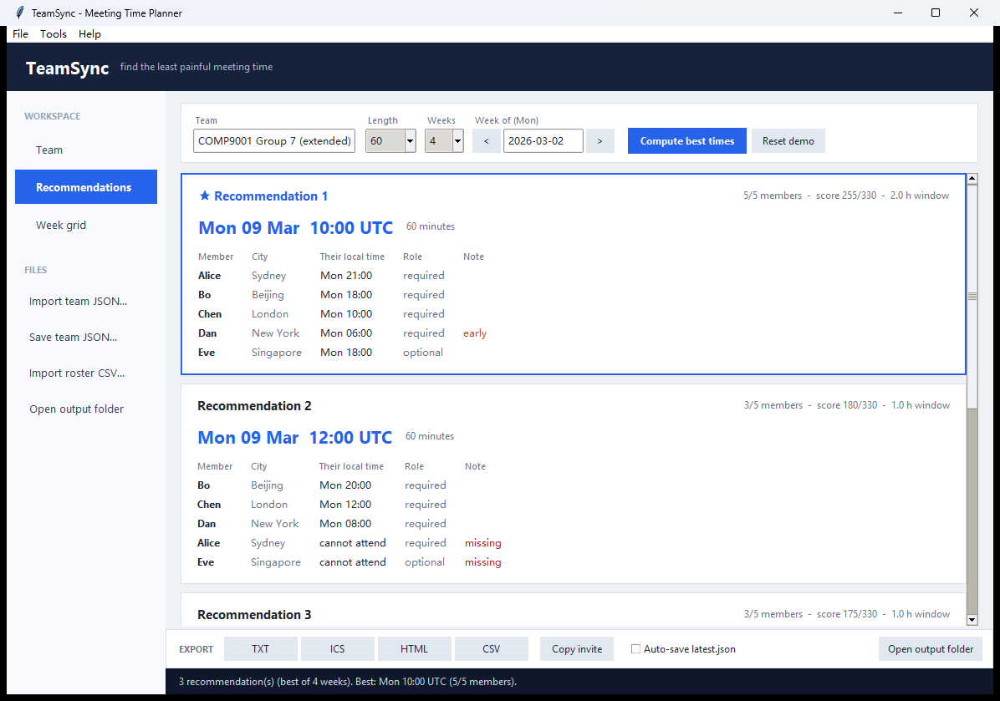

# TeamSync

**Find the least painful meeting time for a team spread across time zones.**



TeamSync takes each member's city and weekly availability, scores every half
hour of the week by who can attend and how civilised the local time is, and
ranks the best times — with every member's own clock. It runs as a desktop app,
a terminal menu, or a one-shot batch command, and uses the Python standard
library only: no installation, no network, timezone data bundled.

## Features

- **Ranked recommendations** — all required members present, then attendees,
  then comfort, then the earliest time.
- **Required and optional attendees** — an optional member adds a bonus instead
  of blocking the meeting.
- **Days away** — per-member local dates (leave, exams, public holidays).
- **Calendar import (.ics)** — one-off events and daily/weekly repeats become
  busy time, expanded in the event's own timezone.
- **Roster import (.csv)** — load a whole team from a spreadsheet.
- **Multi-week scan** — compares several weeks and reports daylight-saving
  switches.
- **Weekly heatmap** — colour-coded coverage; click any hour to see every
  member's local time and why somebody cannot come.
- **Four exports** — TXT, ICS (calendar), HTML (coloured report) and CSV
  (spreadsheet), plus a one-click **Copy invite** message.

## Requirements

- Python **3.9+** (tested on 3.11 and 3.13).
- **tkinter** for the window (ships with the official Python installer). Without
  it, `python main.py` falls back to the terminal menu instead of crashing.
- Nothing else: `zoneinfo`, `json`, `csv`, `datetime` and `argparse` are all
  standard library, and the IANA timezone files are bundled in `data/tzfiles/`.

## Quick start

```bash
cd TeamSync

python main.py            # open the desktop app
python main.py --cli      # terminal menu
python main.py --report   # print a report and exit
python -m unittest discover tests
```

The window opens on a four-person demo team, so there is something to try
immediately. Press **Compute best times**.

## How to use it

### 1. Add your team

Open the **Team** page and press **Add member**. Each person has:

| Field | Meaning | Example |
| --- | --- | --- |
| Name | Display name | `Alice` |
| City | Any city from `data/cities.json` (47 cities, English or Chinese aliases) | `Sydney` |
| Attendance | Required or optional | `Required` |
| Days | Weekdays the window starts on | `Mon-Fri` |
| Local windows | When they are free, in their local time | `09:00-12:00 + 18:00-22:00` |
| Away dates | Whole local dates they are unavailable | `2026-03-04, 2026-03-06..2026-03-08` |

You can also press **Import roster CSV...** and load a spreadsheet:

```csv
name,city,role,days,windows,away
Alice,Sydney,required,Mon-Fri,19:00-23:00,
Bo,Beijing,required,Mon-Fri,09:00-12:00; 18:00-22:00,
Chen,London,required,Mon-Fri,09:00-15:00,
Eve,Singapore,optional,Mon-Fri,08:00-20:00,2026-03-04
```

### 2. Optional: import a calendar

Select a member, press **Import busy .ics...**, and choose a calendar file.
One-off events and daily/weekly repeats become busy time; all-day events and
monthly/yearly repeats are skipped with a warning. Any calendar app that can
export `.ics` works (Google Calendar: *Settings → Import & export → Export*).

The sidebar also has *Import team JSON...* / *Save team JSON...* for storing
everything, including imported calendars, in one file.

### 3. Compute and read the result

Set **Length**, **Weeks** and the **week**, then press **Compute best times**.
The **Recommendations** page shows one card per ranked slot: the UTC time, each
member's local start time, their role and a note (`late`, `early`, `missing`).
The top card has a blue border. The **Week grid** page shows a coverage heatmap:
green means everybody is free; click a cell (or hover for a quick read-out) to
see the explanation. The arrows next to the week move one week at a time.

### 4. Export or share

| Button | Output |
| --- | --- |
| TXT | `output/meeting_<week>.txt` — plain report for chat or a slide |
| ICS | `output/meeting_<week>.ics` — imports into Outlook / Apple Calendar / Google Calendar |
| HTML | `output/meeting_<week>.html` — single-file report with the heatmap |
| CSV | `output/meeting_<week>.csv` — one row per slot, one column per member |
| Copy invite | A ready-to-paste message with everyone's local time |

### Terminal and batch mode

```bash
python main.py --cli
```

The menu offers: show team, add member, plan a meeting, compare weeks, check
meeting lengths, explain a time, import `.ics`, import `.csv`, change reference
timezone, save/load, open the window, export.

Batch mode is non-interactive, which is handy for scripts and demos:

```bash
python main.py --report
python main.py --week 2026-04-06 --duration 90 --report
python main.py --weeks 4 --file data/demo_team_extended.json
python main.py --export txt,ics,html,csv
```

| Flag | Meaning |
| --- | --- |
| `--file PATH` | Team JSON to load (default `data/demo_team.json`) |
| `--week YYYY-MM-DD` | Any day of the week to plan (snaps back to Monday) |
| `--duration MIN` | Meeting length |
| `--top N` | How many recommendations (default 3) |
| `--weeks N` | Compare N consecutive weeks |
| `--report` | Print the report and exit |
| `--export FMT[,FMT]` | Write files and exit |
| `--cities` | List the bundled cities |

## Team file format

```json
{
  "team": "COMP9001 Group 7",
  "week": "2026-03-02",
  "duration_min": 60,
  "members": [
    {
      "name": "Alice",
      "city": "Sydney",
      "tzkey": "Australia/Sydney",
      "away": ["2026-03-06"],
      "availability": [
        { "days": ["Mon", "Tue", "Wed", "Thu", "Fri"],
          "start": "19:00", "end": "23:00" }
      ]
    }
  ]
}
```

`tzkey` may be omitted (looked up from `city`), `required` defaults to `true`,
and `away`, `busy` are only written when non-empty. `start > end` wraps past
midnight; `start == end` means all day.

## How the scoring works

Every half hour of the Monday–Friday UTC week is a candidate start.

```text
coverage   required member  = 40        optional member = 20
comfort    09:00-18:00      = 30
           07:00-09:00 / 18:00-22:00 = 15
           anything else     = 0        weekend = -10
```

Only the **start** cell is scored (so a longer meeting is not rewarded for
touching more cells). Ranking is: all required present → number of attendees →
score → earlier time. That is what makes an optional member a bonus rather than
a blocker.

## Project layout

```text
TeamSync/
├── main.py          entry point: window / menu / batch
├── gui.py           tkinter window (pages, cards, heatmap)
├── models.py        data classes and parsing
├── cities.py        city lookup + bundled timezone loading
├── ics_import.py    .ics parser → busy blocks
├── planner.py       scan → segments → rank → multi-week
├── render.py        pure text output
├── storage.py       JSON / TXT / ICS / HTML / CSV
├── data/            cities, demo teams, sample calendar and roster, TZif files
├── tests/           107 tests (planner, features, imports, CLI)
├── docs/            presentation script, Padlet notes, screenshots
└── output/          generated files
```

## Tests

```text
$ python -m unittest discover tests
Ran 107 tests in 1.7s
OK
```

The suite covers timezone maths, midnight windows, scoring and ranking, roles,
away dates, the multi-week scan and daylight saving, the `.ics` parser, the CSV
roster, all four exports, and every menu option and batch flag. GUI tests skip
themselves when tkinter or a display is missing.

## Good to know

- The scan covers Monday–Friday in UTC; at the extremes (UTC±12) a sliver of
  the local week can be clipped.
- Comfort scores the meeting **start time** only; a meeting crossing midnight is
  not special-cased.
- Calendar import handles one-off events and daily/weekly repeats; all-day
  events and monthly/yearly repeats are skipped with a warning (use away dates).
- Repeating events are expanded eight weeks from the planned week.

## More documentation

- [`docs/PRESENTATION.md`](docs/PRESENTATION.md) — three-minute demo script.
- [`docs/PADLET.md`](docs/PADLET.md) — title, image and description for Padlet.
- `docs/screenshots/` — window and report screenshots.
- A bilingual code walkthrough (`code_review.md`) is kept with the submission.

